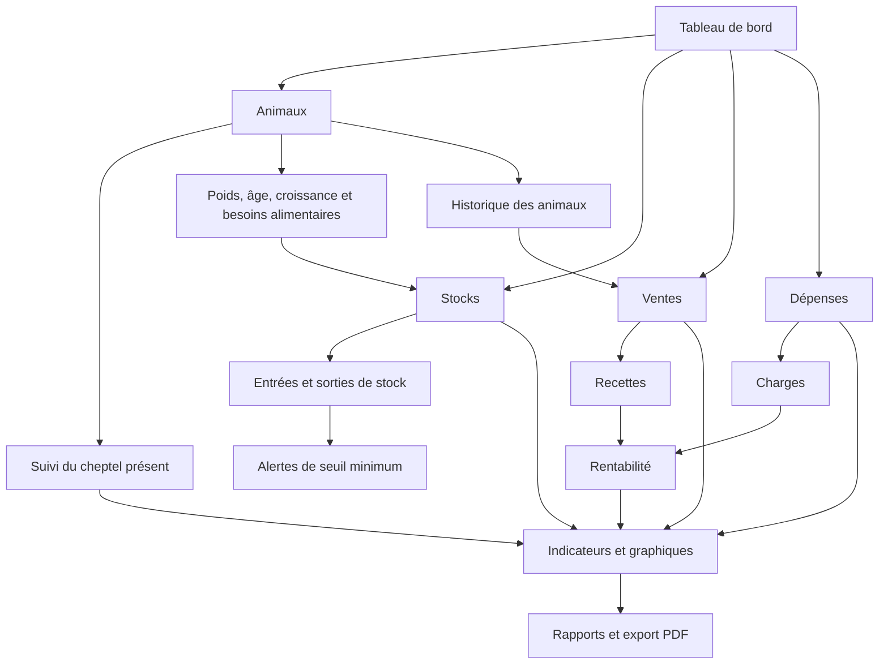

# Ma Ferme Connectée — Diagramme de fonctionnement

> Document de référence du projet. À conserver pendant les prochaines évolutions.
> Ce diagramme décrit le fonctionnement attendu ; il ne signifie pas que tous les flux sont déjà implémentés ou testés.

## Vue d'ensemble

## Rôle de chaque module

1. **Animaux** — créer et consulter une fiche par animal ; suivre son identifiant, sa catégorie, son sexe, son âge, son poids et son évolution. Le statut est Présent, Vendu ou Mort. Les nouvelles fiches sont Présent par défaut. Les fiches vendues ou mortes restent dans l'historique et ne sont plus comptées dans le cheptel présent.
2. **Stocks** — suivre les quantités disponibles, les entrées, les consommations et les sorties (aliments et produits vétérinaires). Prévoir des alertes lorsque le stock passe sous le seuil configuré, notamment le seuil de 5 000 kg demandé pour les stocks concernés.
3. **Ventes** — enregistrer chaque vente avec date, animal ou référence, quantité/poids, prix et recette. Une vente doit pouvoir être reliée à la fiche de l'animal ; le passage au statut Vendu doit être contrôlé pour éviter les incohérences.
4. **Dépenses** — enregistrer les charges avec date, catégorie, montant et justificatif éventuel : alimentation, soins, salaires, entretien, transport et autres frais.
5. **Rentabilité** — calculer les recettes moins les dépenses sur une période sélectionnée. Afficher le chiffre d'affaires, les charges et le résultat, avec possibilité de consulter le détail. Ne pas confondre trésorerie, marge et bénéfice comptable.

## Règles de cohérence à préserver

- Le compteur du cheptel, le poids total et l'estimation de ration du tableau de bord ne prennent en compte que les animaux **Présents**.
- Les animaux **Vendus** et **Morts** sont conservés pour l'historique, mais exclus des effectifs présents et des besoins alimentaires courants.
- Une vente enregistrée doit être rapprochée d'un animal lorsque c'est possible ; éviter de compter deux fois un animal ou une recette.
- Les sorties d'aliments liées aux rations doivent diminuer le stock de façon traçable ; éviter les sorties automatiques tant que les règles et validations ne sont pas définies.
- Les dépenses et recettes doivent garder leur date et leur historique ; les corrections doivent être traçables.
- Les alertes de stock doivent être visibles dans l'application. Les notifications sur téléphone nécessitent une étape technique et des essais distincts.
- Les rapports PDF doivent reprendre les données filtrées et la période choisie.

## Parcours opérationnel type

1. Enregistrer les animaux à leur arrivée.
2. Mettre à jour poids, âge, catégorie et suivi sanitaire.
3. Calculer les besoins de ration et suivre les consommations de stock.
4. Enregistrer les achats et autres dépenses.
5. Enregistrer les ventes et associer les animaux concernés.
6. Vérifier le statut des animaux vendus ou morts.
7. Consulter le tableau de bord et la rentabilité par période.
8. Exporter les rapports nécessaires.

## État et prochaines étapes

- [ ] Vérifier chaque flux dans l'application avec des données de test.
- [ ] Définir précisément le lien entre une vente et une fiche animal.
- [ ] Définir les mouvements de stock (entrée, consommation, correction, inventaire) et leurs validations.
- [ ] Définir les catégories de dépenses et les règles de calcul de rentabilité.
- [ ] Ajouter des filtres par période et des rapports PDF cohérents.
- [ ] Tester les alertes et les notifications sur téléphone.
- [ ] Vérifier les droits d'accès : données financières et tableaux de rentabilité réservés à l'administrateur.

**Précaution :** ce document est une référence fonctionnelle. Il ne modifie pas la base Supabase, ne supprime aucune donnée et ne déploie pas le site.
